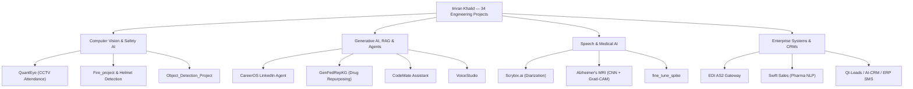

# Imran Khalid — AI/ML & Full-Stack Engineering Portfolio (34 Projects)

> **AI & Machine Learning Team Lead @ QIntellect Technologies**  
> Complete engineering catalog of production AI systems, research frameworks, enterprise backends, and full-stack applications.

## Portfolio Domain Map

## Full Catalog
See **[PROJECTS.md](./PROJECTS.md)** for the complete 34-project breakdown—each with its **Tagline**, **Problem Statement**, **Detailed Description**, and **Tech Stack**.
